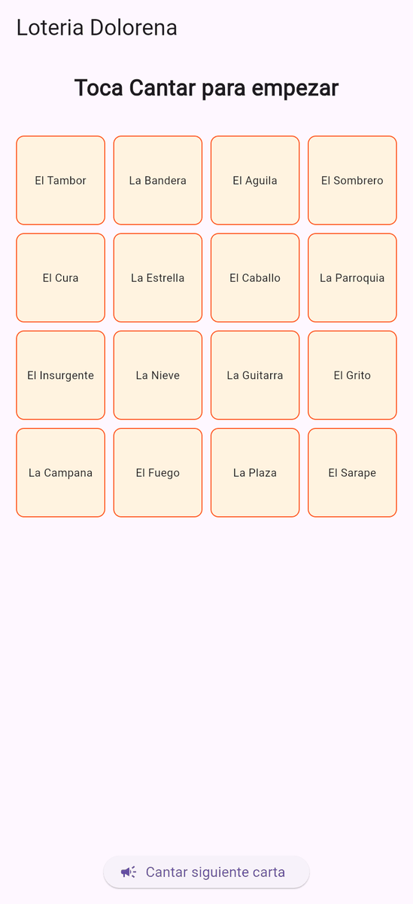
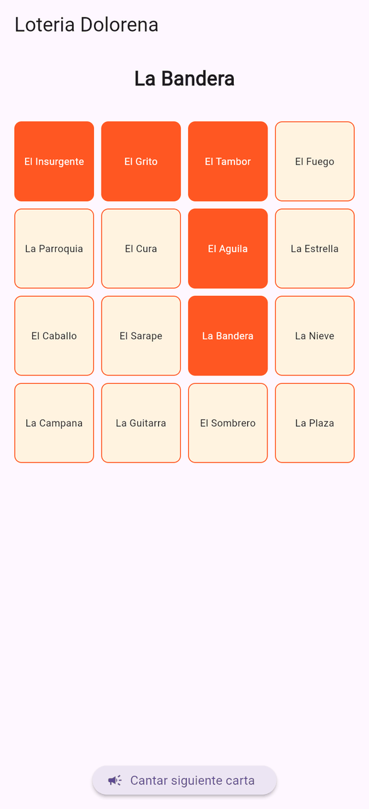
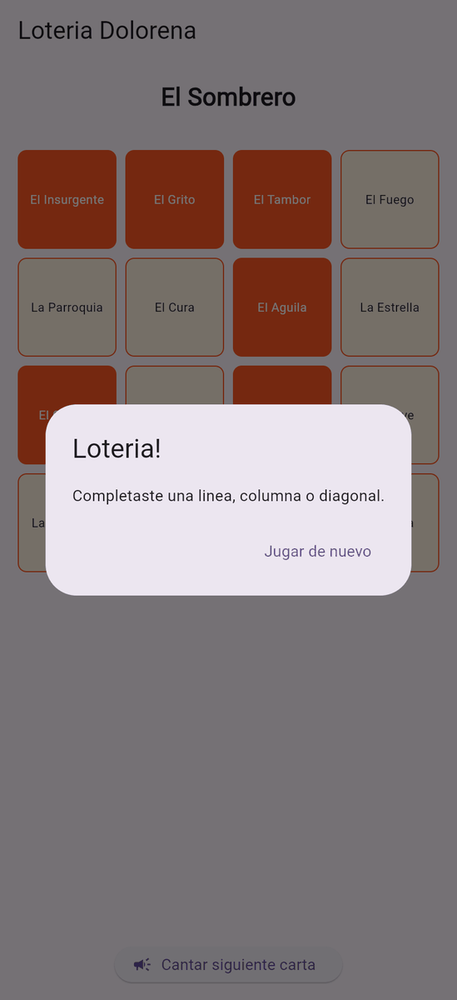
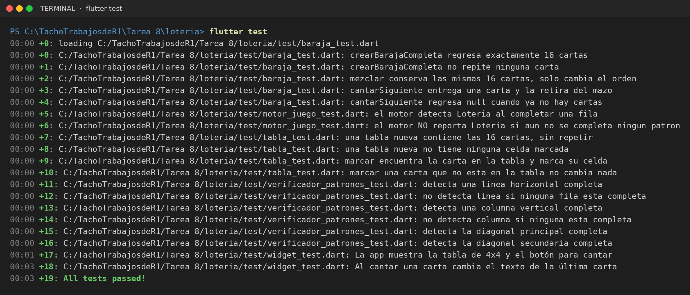

# Lotería Doloreña

Juego de **lotería mexicana** en **Flutter** con cartas temáticas de Dolores Hidalgo. La app canta cartas al azar, marca automáticamente las que salen en tu tabla de 4×4 y avisa cuando completas una línea, una columna o una diagonal.

| | |
|---|---|
| **Alumno** | Cristopher Gerardo Villanueva Ramírez |
| **Materia** | Desarrollo de Aplicaciones Móviles |
| **Tarea** | 8 |

## Capturas de pantalla

<table>
  <tr><td align="center"><br><sub>Tabla al iniciar</sub></td><td align="center"><br><sub>Cartas cantadas y marcadas</sub></td><td align="center"><br><sub>¡Lotería!</sub></td></tr>
</table>

## Cómo funciona

- **Baraja:** se crea la baraja completa y se mezcla.
- **Tabla:** se genera una tabla de 4×4 con cartas de la baraja.
- **Motor de juego:** cada vez que tocas *Cantar siguiente carta* saca una carta y, si está en tu tabla, la marca.
- **Verificador de patrones:** revisa si hay una **línea**, **columna** o **diagonal** completa; si la hay, muestra el diálogo *¡Lotería!* y permite jugar de nuevo.

## Estructura

```
lib/
├── main.dart                  # JuegoScreen
├── modelos/carta.dart
└── logica/
    ├── baraja.dart
    ├── tabla.dart
    ├── motor_juego.dart
    └── verificador_patrones.dart
test/
├── baraja_test.dart
├── tabla_test.dart
├── motor_juego_test.dart
└── verificador_patrones_test.dart
```

## Pruebas (`flutter test`)

Resultado de correr `flutter test`: **19 pruebas pasan** (*All tests passed!*). Las pruebas están en [`test/`](test/).



## Cómo ejecutar

```bash
flutter pub get
flutter test
flutter run
```
